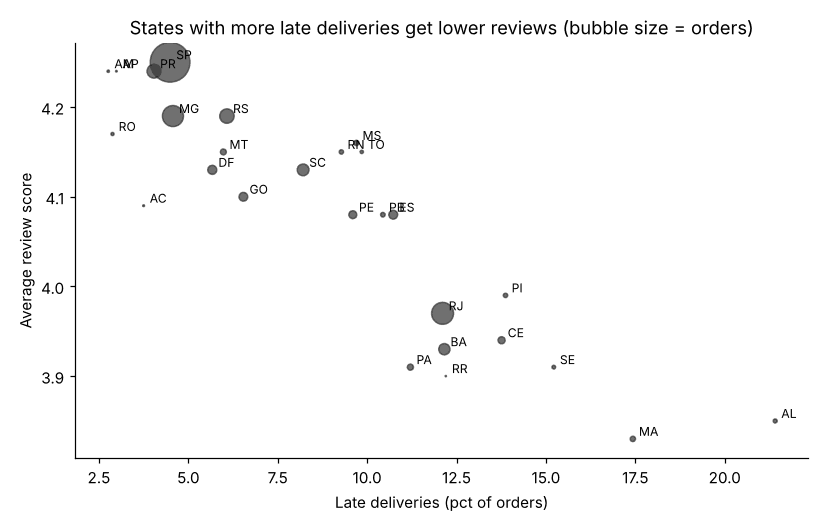

# Delivery and seller performance dashboard (Tableau)

**Question.** Where in Brazil does a marketplace break its delivery promise, which sellers cause it, and how much does it cost in customer reviews?

**Answer in one line.** Late deliveries are concentrated, not random: Rio de Janeiro runs at 12.1% late against 4.5% in São Paulo, two peak periods (Black Friday 2017 and February to March 2018) pushed the late rate to between 12% and 19%, and 78 sellers with more than 10% late orders average 3.88 stars against 4.26 for reliable sellers.

**Live dashboard on Tableau Public:** [Delivery Performance Dashboard](https://public.tableau.com/app/profile/varun.rathi8429/viz/DeliveryPerformanceDashboard_17952813858150/DeliveryDashboard)

## Approach

* Built three Tableau ready tables from the Olist marketplace data (96,478 delivered orders, 2016 to 2018) with SQL in `prepare.py`: performance by customer state, delivery trend by month, and a scorecard for the 425 sellers with at least 50 orders.
* Built and published a one page Tableau Public dashboard: four KPI tiles, a filled map of order weighted late rate by state, a monthly trend of late rate against review score, and a seller scatter of late rate against review score coloured by tier, with the three findings on the page.
* The same files drive a Python preview chart so the finding can be seen without Tableau.

## Key findings

* **Geography.** São Paulo (40,494 orders) has 4.5% late deliveries and an average review of 4.25. Rio de Janeiro, the second biggest market (12,350 orders), has 12.1% late and 3.97. The worst states are Alagoas (21.4% late) and Maranhão (17.4%).
* **Timing.** Late rate jumped to 12.4% in November 2017 and to 14.1% and 19.0% in February and March 2018; average review fell to 3.81 in March 2018. By June 2018 the late rate was 1.2%.
* **Sellers.** Of 425 sellers with 50 or more orders, 78 are late on more than 10% of orders. They handled 10,515 orders and BRL 1.40 million of sales, and average 3.88 stars against 4.26 for the 181 sellers late on under 5% of orders.
* **Freight.** Freight is 13.9% of item price for São Paulo customers and 20% to 28% for most north and north east states.



## Recommendation

* Put the 78 problem sellers on a delivery improvement plan with a published late rate target, and pad their promised dates until they meet it.
* Add carrier capacity or longer promised dates for Rio de Janeiro and the north east before peak periods; the November and February to March spikes show where the network breaks.
* Track the dashboard weekly: late rate by state and the seller tier mix are the two leading indicators of review score.

## Files

```
TableauDeliveryDashboard/
  README.md                      this summary
  Build Guide.md                 Tableau steps: data, calculated fields, sheets, dashboard, publishing
  prepare.py                     builds the three data files with SQL
  data/state performance.csv     27 states
  data/monthly delivery.csv      January 2017 to August 2018
  data/seller scorecard.csv      425 sellers (anonymised)
  charts/preview.png             Python preview of the main view
  tableau/Delivery Performance Dashboard.twbx   packaged workbook (open in Tableau Public)
  tableau/Delivery Performance Dashboard.twb    the same workbook as readable XML
  tableau/*.csv                  Tableau ready copies of the data
```

## Tools

Tableau Public (filled map, calculated fields for order weighted rates, trend lines, scatter, KPI tiles, dashboard), SQL in SQLite, Python (pandas, matplotlib).

## How to run

1. Open the live dashboard from the link above, or open `tableau/Delivery Performance Dashboard.twbx` in Tableau Public (free). The Build Guide shows how to rebuild it from the CSV files.
2. To rebuild them, first run the MarketplaceUnitEconomics project to create `olist.db`, copy it into this folder, then run `pip install pandas matplotlib` and `python prepare.py`.

Data: Olist, Brazilian E Commerce Public Dataset, Kaggle, CC BY NC SA 4.0.
